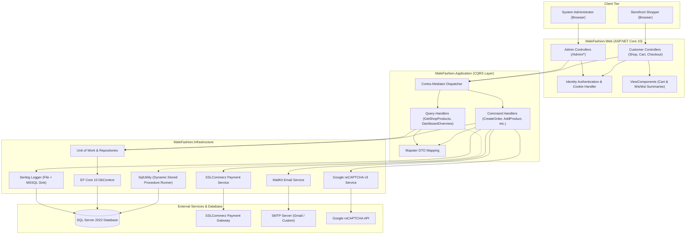

# Male Fashion — Modern Clean Architecture eCommerce Platform

[](https://dotnet.microsoft.com/)
[](https://learn.microsoft.com/en-us/dotnet/csharp/)
[](https://learn.microsoft.com/en-us/ef/core/)
[](https://www.microsoft.com/sql-server)
[](https://www.docker.com/)
[](#testing--quality-assurance)
[](#system-architecture)

**Male Fashion** is an enterprise-grade, full-stack eCommerce web application built with **ASP.NET Core 10**, strictly adhering to **Clean Architecture** and the **CQRS (Command Query Responsibility Segregation)** pattern. It features a responsive customer-facing storefront and a feature-rich, role-guarded administrative backoffice.

---

## Table of Contents

- [Key Features](#key-features)
  - [Customer Storefront](#customer-storefront)
  - [Admin Backoffice Portal](#admin-backoffice-portal)
  - [Security & Infrastructure Integrations](#security--infrastructure-integrations)
- [System Architecture](#system-architecture)
  - [Architecture Layers](#architecture-layers)
  - [Architecture Flow Diagram](#architecture-flow-diagram)
- [High-Performance Stored Procedure (`dbo.GetShopProducts`)](#high-performance-stored-procedure-dbogetshopproducts)
- [Tech Stack & Libraries](#tech-stack--libraries)
- [Project Directory Structure](#project-directory-structure)
- [Getting Started](#getting-started)
  - [Prerequisites](#prerequisites)
  - [Option 1: Quickstart with Docker Compose (Recommended)](#option-1-quickstart-with-docker-compose-recommended)
  - [Option 2: Local Development (.NET CLI)](#option-2-local-development-net-cli)
- [Default Seed Data & Access Credentials](#default-seed-data--access-credentials)
- [Configuration Reference (`.env` & `appsettings.json`)](#configuration-reference-env--appsettingsjson)
- [Testing & Quality Assurance](#testing--quality-assurance)
- [Database Migrations](#database-migrations)
- [License & Acknowledgments](#license--acknowledgments)

---

## Key Features

### Customer Storefront
- **Dynamic Catalog & Filtering**: Faceted search with filtering by Category, Brand, Price Range, Sizes, Colors, and Product Tags.
- **Optimized SQL Stored Procedure**: Fast search and sorting (`Newest`, `Price: Low to High`, `Price: High to Low`, `Rating`, `Alphabetical`) powered by parameterized T-SQL procedures with dynamic SQL injection prevention.
- **Product Details & Variants**: Multi-variant support (size, color, SKU-level inventory), interactive image galleries, deal countdown banners, and real-time stock counters with low-stock warnings.
- **Shopping Cart**: Real-time quantity adjustments, discount coupon redemption, subtotal calculations, and seamless synchronization between guest cookies and authenticated user sessions.
- **Wishlist Management**: Instant one-click toggle with header counter badges via dedicated ViewComponents.
- **Checkout & Multi-Payment**:
  - **Online Payment**: Integrated **SSLCommerz Payment Gateway** with sandbox support, instant IPN validation, fail/cancel handling, and transaction tracking.
  - **Cash on Delivery (COD)**: Instant order confirmation.
- **Order Tracking**: Real-time order progress tracking by Order Number with detailed delivery statuses (`Pending`, `Processing`, `Shipped`, `Delivered`, `Cancelled`).
- **Customer Reviews & Ratings**: Authenticated customer ratings and feedback with backoffice moderation.
- **Interactive CMS & Blog**: Engaging fashion blog posts, comments system, hero sliders, client logos, and team showcases.
- **Support & Newsletter**: Inquiry submission protected by Google reCAPTCHA v3 and newsletter subscription management.

### Admin Backoffice Portal
- **Role-Based Access Control (RBAC)**: Secure `/Admin` area with convention-based authorization (`AdminAreaAuthorizationConvention`) and separate authentication redirect flows.
- **Analytical Dashboard**: Executive metrics overview including total revenue, order count, registered customers, low-stock inventory alerts, and recent transactions.
- **Catalog Management**:
  - **Brands & Categories**: Create, edit, toggle status, and delete with DataTables server-side pagination and search.
  - **Products & Variants**: Manage core product specifications, multiple variants (SKU, price, stock, low-stock thresholds), and high-resolution image galleries.
- **Order Management**: Order lifecycle controls, payment verification, customer delivery address details, line-item summaries, and printable customer invoices.
- **Promotions Engine**:
  - **Coupons**: Percentage and fixed-amount coupon codes with expiry dates, minimum spend thresholds, and maximum usage counters.
  - **Deal Countdowns**: Time-limited flash sales with target product eligibility and automated price recalculation.
- **Content Management System (CMS)**: Manage Hero Carousel Sliders, Client/Partner Logos, Testimonials, and Team Members.
- **Customer Directory**: View customer profiles, contact info, total orders placed, and lifetime spend history.
- **Audit & Diagnostics**: Centralized structured logging to Microsoft SQL Server (`Logs` table) via Serilog.

### Security & Infrastructure Integrations
- **ASP.NET Core Identity**: Password hashing, lockout policies, claim/role management, and cookie authentication.
- **SSLCommerz Hosted Checkout**: Secure eCommerce transactions with automated payment validation and IPN callback listeners.
- **Google reCAPTCHA v3**: Non-intrusive background bot detection on sensitive forms (Contact inquiries, registration).
- **MailKit / MimeKit Emailing**: Production-ready SMTP email notifications for order receipts and inquiries over SSL/TLS.
- **Dual Serilog Sinks**: Simultaneous rolling daily file logging (`Logs/log-.log`) and relational SQL logging with auto-created tables.

---

## System Architecture

The solution is architected following **Clean Architecture (Onion Architecture)** principles combined with the **CQRS (Command Query Responsibility Segregation)** pattern:

```
┌────────────────────────────────────────────────────────────┐
│                    MaleFashion.Web                         │
│   (Presentation: MVC Controllers, Views, ViewComponents,  │
│          Admin Area, Static Assets, Program.cs)            │
└─────────────────────────────┬──────────────────────────────┘
                              │
                              ▼
┌────────────────────────────────────────────────────────────┐
│                 MaleFashion.Application                    │
│   (CQRS Commands & Queries, Handlers, DTOs, Behaviors,     │
│         Mapster Profiles, Business Logic Contracts)        │
└─────────────────────────────┬──────────────────────────────┘
                              │
               ┌──────────────┴──────────────┐
               ▼                             ▼
┌────────────────────────────┐ ┌─────────────────────────────┐
│    MaleFashion.Domain      │ │ MaleFashion.Infrastructure  │
│  (Entities, Value Objects, │ │ (EF Core DbContext, UoW,    │
│    Enums, Core Contracts)  │ │  Repositories, Identity,    │
└────────────────────────────┘ │  MailKit, SSLCommerz, SQL)  │
                               └─────────────────────────────┘
```

### Architecture Layers

1. **`MaleFashion.Domain`**
   - Core domain models with zero external framework dependencies.
   - Contains Entities (`Product`, `Order`, `Customer`, `Cart`, `Coupon`, `BlogPost`), Enums (`OrderStatus`, `PaymentStatus`, `DiscountType`), Value Objects, and Domain Contracts.

2. **`MaleFashion.Application`**
   - Houses application use cases using CQRS with `Cortex.Mediator`.
   - Organizes features into dedicated folders (`Catalogs`, `Carts`, `Ordering`, `Promotions`, `CMS`, `Blogs`, `Support`).
   - Handles object transformations using `Mapster` and defines service interfaces (`IEmailService`, `ISSLCommerzService`, `ISqlUtility`, `IFileStorageService`).

3. **`MaleFashion.Infrastructure`**
   - Implements data access via **Entity Framework Core 10** (`ApplicationDbContext`), Generic Repositories, and `ApplicationUnitOfWork`.
   - Contains Entity configurations (`Configurations/`), database migrations (`Migrations/`), and seed data (`Seeds/`).
   - Concrete service implementations: `MailKit` SMTP sender, `SSLCommerz` payment client, `Google reCAPTCHA v3` verification, and session services.

4. **`MaleFashion.Web`**
   - Presentation layer hosting ASP.NET Core 10 MVC.
   - Separate storefront controllers and an `/Admin` area with dedicated layout templates (`Sneat` Admin template for backoffice, `MaleFashion` Bootstrap template for storefront).
   - Custom middleware, authorization conventions, and Serilog configuration.

5. **`MaleFashion.Application.UnitTests`**
   - Unit testing suite with **237 comprehensive tests** validating commands, queries, pagination, validation logic, and business rules using **NUnit 4**, **Moq**, **Autofac.Extras.Moq**, and **Shouldly**.

---

### Architecture Flow Diagram



---

## High-Performance Stored Procedure (`dbo.GetShopProducts`)

To guarantee millisecond-level responsiveness for the storefront catalog under high traffic, catalog filtering and sorting bypass traditional ORM overhead in favor of a specialized T-SQL stored procedure: `[dbo].[GetShopProducts]`.

**Highlights of the procedure:**
- **Dynamic Where Clause with Parameter Sanitization**: Efficiently combines filters (`CategoryId`, `BrandId`, `PriceFrom`, `PriceTo`, `Size`, `Color`, `TagName`, and `SearchText`).
- **SQL Injection Defense**: Strict whitelisting for sort expressions (`priceasc`, `pricedesc`, `rating`, `nameasc`, `namedesc`, `newest`).
- **Active Deal Price Resolution**: Automatically computes effective price between Base Price, Sale Price, and ongoing active Deal Countdown discounts.
- **Two-Pass Pagination**: Calculates both absolute `@Total` and filtered `@TotalDisplay` counts while returning only the requested slice (`@PageIndex`, `@PageSize`).

> [!NOTE]
> The stored procedure is managed directly in EF Core migrations (`20260916233648_GetShopProductsSP.cs` and `20260928223239_UpdateGetShopProductsSP.cs`). A standalone script is also maintained at [`GetShopProducts_StoredProcedure.sql`](file:///F:/C%23/DevSkill/jobayerhossen_aspnet_b13/GetShopProducts_StoredProcedure.sql).

---

## Tech Stack & Libraries

| Category | Technology / Library | Purpose |
| :--- | :--- | :--- |
| **Framework** | **ASP.NET Core 10 (.NET 10.0)** | Cross-platform web framework |
| **Language** | **C# 13** | Primary programming language |
| **Database** | **Microsoft SQL Server 2022** | Relational database storage |
| **ORM** | **Entity Framework Core 10** | Object-Relational Mapper & Code-First Migrations |
| **CQRS / Mediator** | **`Cortex.Mediator` (v3.1.2)** | In-process messaging for commands, queries, and behaviors |
| **Object Mapping** | **`Mapster` (v10.0.12)** | High-performance DTO mapping |
| **Authentication** | **ASP.NET Core Identity** | User authentication, password hashing, and role security |
| **Email Delivery** | **`MailKit` (v4.17.0)** | RFC-compliant SMTP email client (SSL/TLS supported) |
| **Payment Gateway**| **SSLCommerz Integration** | Hosted payment gateway and IPN processor |
| **Bot Detection** | **Google reCAPTCHA v3** | Risk-score verification for public forms |
| **Logging** | **`Serilog.AspNetCore` (v10.0.0)** | Structured logging to rolling files and SQL Server |
| **Dynamic LINQ** | **`System.Linq.Dynamic.Core`** | Dynamic queries for server-side DataTables |
| **Testing** | **NUnit 4, Moq, Autofac.Extras.Moq, Shouldly** | Unit testing, mocking, and assertions |
| **Frontend Store**| **Bootstrap, jQuery, OwlCarousel, NiceSelect, Slick** | Male Fashion storefront theme |
| **Frontend Admin**| **Sneat Admin Template (Bootstrap 5)** | Responsive dashboard & backoffice administration |
| **Containers** | **Docker & Docker Compose** | Multi-stage image build & microservice orchestration |

---

## Project Directory Structure

```plaintext
MaleFashion/
├── .dockerignore                            # Exclusions for Docker image builds
├── .env.example                             # Environment variable template
├── .gitignore                               # Git file ignore list
├── docker-compose.yml                       # Docker orchestration (Web + SQL Server 2022)
├── GetShopProducts_StoredProcedure.sql       # Standalone catalog stored procedure script
├── MaleFashion.slnx                         # Solution file
├── README.md                                # Project documentation
├── src/
│   ├── MaleFashion.Domain/                  # Core Business Domain (Independent)
│   │   ├── Contracts/                       # Domain repository & entity interfaces
│   │   ├── Entities/                        # Database entities (Product, Order, etc.)
│   │   ├── Enums/                           # Domain enumeration types
│   │   └── Utilities/                       # Paging and DataTables response models
│   ├── MaleFashion.Application/             # Use Cases & Application Business Logic
│   │   ├── Contracts/                       # Application service interfaces
│   │   ├── Features/                        # CQRS Commands, Queries, and Handlers
│   │   │   ├── Blogs/                       # Blog posts & comment management
│   │   │   ├── Carts/                       # Cart sessions & coupon applications
│   │   │   ├── Catalogs/                    # Categories, Brands, Products, Variants
│   │   │   ├── CMS/                         # Hero slides, Testimonials, Team, Partners
│   │   │   ├── Customers/                   # Customer profiles & account data
│   │   │   ├── Dashboard/                   # Admin KPIs and metrics
│   │   │   ├── Home/                        # Storefront home page data aggregator
│   │   │   ├── Ordering/                    # Order placement, status, payments
│   │   │   ├── Promotions/                  # Coupons & Deal Countdowns
│   │   │   ├── Reviews/                     # Customer reviews & ratings
│   │   │   ├── Support/                     # Inquiries & newsletter subscribers
│   │   │   └── Wishlists/                   # Wishlist item toggles
│   │   └── Mapping/                         # Mapster transformation configurations
│   ├── MaleFashion.Infrastructure/          # External Concerns & Data Access
│   │   ├── Data/
│   │   │   ├── Configurations/              # EF Core Fluent API model configurations
│   │   │   ├── Migrations/                  # EF Core database migrations
│   │   │   ├── Repositories/                # Generic & specialized repositories
│   │   │   ├── Seeds/                       # Default roles and admin user seeds
│   │   │   ├── ApplicationDbContext.cs      # Core EF Core DbContext
│   │   │   └── ApplicationUnitOfWork.cs     # Unit of Work pattern implementation
│   │   ├── Extensions/                      # Dependency Injection service extensions
│   │   ├── Identity/                        # ASP.NET Core Identity custom user & roles
│   │   └── Services/                        # MailKit, SSLCommerz, ReCaptcha, Sessions
│   └── MaleFashion.Web/                     # Presentation Layer (ASP.NET Core 10)
│       ├── Areas/
│       │   └── Admin/                       # Role-protected Admin Backoffice
│       │       ├── Controllers/             # Admin management controllers
│       │       ├── Conventions/             # Custom route & authorization conventions
│       │       ├── Models/                  # Admin ViewModels
│       │       └── Views/                   # Sneat Admin Razor Views
│       ├── Controllers/                     # Storefront MVC Controllers
│       ├── Models/                          # Storefront ViewModels
│       ├── ViewComponents/                  # Reusable Razor components
│       ├── Views/                           # Storefront Razor Views
│       ├── wwwroot/                         # CSS, JS, Vendor libs, and Uploads
│       ├── appsettings.json                 # Default configuration file
│       ├── Dockerfile                       # Multi-stage container build definition
│       └── Program.cs                       # App entry point, DI, & middleware pipeline
└── tests/
    └── MaleFashion.Application.UnitTests/   # 237 NUnit Unit Tests covering CQRS features
```

---

## Getting Started

### Prerequisites

Ensure the following tools are installed on your workstation:
- **[.NET 10.0 SDK](https://dotnet.microsoft.com/download)**
- **[Git](https://git-scm.com/)**
- **Option A (Docker)**: **[Docker Desktop](https://www.docker.com/products/docker-desktop/)**
- **Option B (Local)**: **[Microsoft SQL Server 2022](https://www.microsoft.com/sql-server)** or **LocalDB**, and **[EF Core CLI](https://learn.microsoft.com/en-us/ef/core/cli/dotnet)** (`dotnet tool install --global dotnet-ef`)

---

### Option 1: Quickstart with Docker Compose (Recommended)

The easiest way to boot the entire stack (ASP.NET Core Web App + SQL Server 2022 + auto-migrations) is with Docker Compose.

1. **Clone the repository**:
   ```bash
   git clone https://github.com/your-username/jobayerhossen_aspnet_b13.git
   cd jobayerhossen_aspnet_b13
   ```

2. **Prepare the Environment File**:
   Copy the sample environment file to `.env`:
   ```bash
   cp .env.example .env
   ```
   *(On Windows PowerShell: `Copy-Item .env.example .env`)*

3. **Start the Containers**:
   ```bash
   docker compose up -d --build
   ```

4. **Verify Application Health**:
   - The SQL Server container will initialize and run health checks.
   - Once SQL Server is healthy, the `malefashion-web` container starts, automatically runs EF Core migrations, seeds the database, and publishes the store.
   - Open your browser at: **`http://localhost:8080`**
   - Access the Admin Portal at: **`http://localhost:8080/Admin`**

5. **Stop the Containers**:
   ```bash
   docker compose down
   ```
   *(Add `-v` to wipe database volumes if you want a clean slate: `docker compose down -v`)*

---

### Option 2: Local Development (.NET CLI)

1. **Clone the repository**:
   ```bash
   git clone https://github.com/your-username/jobayerhossen_aspnet_b13.git
   cd jobayerhossen_aspnet_b13
   ```

2. **Configure Database Connection**:
   Create an `appsettings.local.json` file inside `src/MaleFashion.Web/` (or update `src/MaleFashion.Web/appsettings.json`):
   ```json
   {
     "ConnectionStrings": {
       "DefaultConnection": "Server=localhost;Database=MaleFashion;Trusted_Connection=True;TrustServerCertificate=True;MultipleActiveResultSets=true"
     }
   }
   ```

3. **Apply EF Core Migrations**:
   Run the database migration command to generate tables, stored procedures, and seed roles/admin:
   ```bash
   dotnet ef database update --project src/MaleFashion.Infrastructure --startup-project src/MaleFashion.Web
   ```

4. **Restore & Run the Web Project**:
   ```bash
   dotnet restore
   dotnet run --project src/MaleFashion.Web
   ```

5. **Navigate in Browser**:
   - Storefront: `https://localhost:7198` (or port indicated in console)
   - Admin Portal: `https://localhost:7198/Admin`

---

## Default Seed Data & Access Credentials

The application is pre-configured with database seeds (`AdminUserSeed.cs` & `RoleSeeds.cs`) providing an administrative account out of the box:

> [!IMPORTANT]
> **Pre-configured Administrator Account (Development / Evaluation):**
> - **Portal URL**: `/Admin` or `/Admin/Account/Login`
> - **Email**: `admin@malefashion.com`
> - **Password**: `Admin@123456`
> - **Role**: `Admin`
>
> *Always change the default administrator credentials before deploying to a public or production environment.*

---

## Configuration Reference (`.env` & `appsettings.json`)

| Variable / Setting Key | Default Value | Description |
| :--- | :--- | :--- |
| `ASPNETCORE_ENVIRONMENT` | `Development` | ASP.NET Core hosting environment (`Development`, `Staging`, `Production`) |
| `WEB_PORT` | `8080` | Host port mapped to the web container |
| `APPLY_MIGRATIONS` | `true` | When `true`, automatically applies pending EF migrations upon container launch |
| `DB_NAME` | `MaleFashion` | Name of the primary SQL Server database |
| `MSSQL_SA_PASSWORD` | `YourStrong@Passw0rd!` | System Administrator (`sa`) password for SQL Server |
| `SQL_PORT` | `1433` | Host port mapped to SQL Server |
| `SmtpSettings:Host` | `smtp.gmail.com` | SMTP server address |
| `SmtpSettings:Port` | `465` | SMTP port (465 for SSL/TLS, 587 for STARTTLS) |
| `SmtpSettings:Username` | *(Optional)* | SMTP account username / email address |
| `SmtpSettings:Password` | *(Optional)* | SMTP app password or credential token |
| `SmtpSettings:FromEmail` | `support@example.com` | Sender email address for automated receipts |
| `SSLCommerz:StoreId` | `testbox` | SSLCommerz Store Identifier (Sandbox / Live) |
| `SSLCommerz:StorePassword` | `qwerty` | SSLCommerz Store Password credential |
| `SSLCommerz:IsSandbox` | `true` | Toggles between Sandbox and Production gateway endpoints |
| `ReCaptcha:SiteKey` | *(Optional)* | Google reCAPTCHA v3 public site key |
| `ReCaptcha:SecretKey`| *(Optional)* | Google reCAPTCHA v3 private secret key |
| `ReCaptcha:IsEnabled`| `false` | Enable or disable bot verification on public forms |

---

## Testing & Quality Assurance

The solution includes an extensive unit test suite located in `tests/MaleFashion.Application.UnitTests/`. Tests are constructed using **NUnit 4**, with dependencies isolated using **Moq** and **Autofac.Extras.Moq**, and assertions formulated with **Shouldly**.

### Test Suite Breakdown

The test suite contains **237 automated tests** covering every feature domain in `MaleFashion.Application`:

| Feature Area | Test Suite Count | Test Focus |
| :--- | :---: | :--- |
| **Blogs** | 10 Suites | Post authoring, editing, approvals, publishing, comments, and paging |
| **Carts** | 11 Suites | Adding items, clearing stale carts, coupon application/removal, calculations |
| **Catalogs** | 23 Suites | Category/Brand/Product CRUD, SKU stock adjustments, and Stored Procedure queries |
| **CMS** | 20 Suites | Hero sliders, partner/client logos, team members, and testimonials |
| **Customers** | 6 Suites | Registration, profile updates, account details, and server-side paging |
| **Dashboard** | 1 Suite | Overview metrics, revenue aggregation, low-stock alerts, and order KPIs |
| **Home** | 1 Suite | Home page aggregated feed, active promotions, and latest arrivals |
| **Ordering** | 10 Suites | Checkout creation, cancellation, status transitions, and payment callbacks |
| **Promotions** | 12 Suites | Coupons validity, discount computations, flash deal countdowns, and timers |
| **Reviews** | 6 Suites | Review creation, moderation workflows, rating aggregates, and deletion |
| **Support** | 16 Suites | Contact inquiries, resolution status toggles, and newsletter subscriptions |
| **Wishlists** | 3 Suites | Toggle items, customer wishlist retrieval, and session synchronization |

### Running the Tests

To run the complete test suite from the CLI:

```bash
dotnet test
```

To run with concise reporting:
```bash
dotnet test --no-restore --verbosity normal
```

Example output:
```plaintext
Passed!  - Failed: 0, Passed: 237, Skipped: 0, Total: 237, Duration: 1 s - MaleFashion.Application.UnitTests.dll (net10.0)
```

---

## Database Migrations

Entity Framework Core Code-First migrations manage the schema and stored procedures.

### Common Migration Commands

- **Add a new migration**:
  ```bash
  dotnet ef migrations add <MigrationName> --project src/MaleFashion.Infrastructure --startup-project src/MaleFashion.Web
  ```

- **Update the database**:
  ```bash
  dotnet ef database update --project src/MaleFashion.Infrastructure --startup-project src/MaleFashion.Web
  ```

- **Generate idempotent SQL script**:
  ```bash
  dotnet ef migrations script --idempotent --project src/MaleFashion.Infrastructure --startup-project src/MaleFashion.Web -o migration.sql
  ```

---

## License & Acknowledgments

- **Framework**: Built with [.NET 10](https://dotnet.microsoft.com/) by Microsoft.
- **Storefront Template**: Male Fashion by [Colorlib](https://colorlib.com/).
- **Admin Template**: Sneat Bootstrap 5 HTML Admin Template by [ThemeSelection](https://themeselection.com/).
- **Payment Processing**: [SSLCommerz](https://sslcommerz.com/).

---

<p align="center">
  <b>Developed by Jobayer Hossen</b><br>
  Built with ❤️ using ASP.NET Core 10 Clean Architecture
</p>

